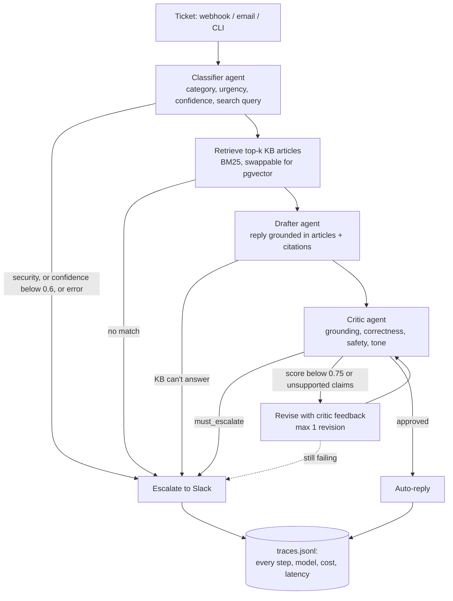

# Support Triage: multi-agent ticket triage with evals

Classifies inbound support tickets and drafts replies from a help-centre knowledge base. A critic agent checks each draft before it can go out, and anything risky, ungrounded or low-confidence goes to a human in Slack along with the best draft so far.

The demo company is **Kettle**, a fictional invoicing app for South African small businesses. The `kb/` folder holds 12 help-centre articles and `evals/dataset.jsonl` holds 100 labelled tickets (69 dev / 31 held-out test).

**Business side:** the [AI Adoption Playbook](https://github.com/mmoshabe/ai-adoption-playbook) turns this system's measured results into a business case (build vs buy, ROI), a gated rollout plan and a POPIA-aware governance checklist.

## Architecture



**Design choices worth talking about in an interview:**
- **Control flow lives in code, not in a prompt.** Each agent is one structured-output LLM call, and `graph.py` decides the route. Every path is deterministic, unit-tested (`tests/`) and visible in the trace. No framework is needed at this size. LangGraph is an easy port later if you want its checkpointing or UI.
- **Typed contracts between agents.** Pydantic schemas plus Claude structured outputs mean no free-text parsing.
- **Fail closed.** API errors, refusals, truncated output and Slack outages all degrade to "a human handles it". They never crash, and they never auto-send.
- **Two error types are tracked separately.** An *unsafe auto-reply* is a bot answer where a human was needed, and it fails CI. An *unnecessary escalation* only costs efficiency.
- **Prompt caching** is on for every system prompt, and cost per ticket is computed from real token usage.

## Quick start

```bash
uv sync
cp .env.example .env                   # add ANTHROPIC_API_KEY (gitignored)
uv run pytest                          # routing + webhook tests, no API calls
uv run python evals/run_eval.py --retrieval-only --split all   # free
uv run triage "Bank feed stopped" "FNB says Reconnect required"
uv run python evals/run_eval.py --limit 5                 # small paid smoke run
uv run python evals/run_eval.py --split dev --judge --tag "v1 ..."   # iterate here
uv run python evals/run_eval.py --split test --judge      # held-out number for this README
uv run uvicorn support_triage.api:app --reload            # POST /tickets, /webhooks/zendesk
```

Optional: set `SLACK_WEBHOOK_URL` to send escalations to Slack, and the `ZENDESK_*` variables to connect Zendesk (setup steps are in `zendesk.py`). Zendesk write-backs are internal notes until `ZENDESK_AUTO_SEND=true`, so you can shadow-run on live tickets first. Without it they are logged. All thresholds and models can be overridden with `TRIAGE_*` env vars (see `config.py`).

## Slack setup (about 10 minutes, free)

1. Create a free Slack workspace (or use one you own) and a channel such as `#support-escalations`.
2. Go to [api.slack.com/apps](https://api.slack.com/apps), then **Create New App**, then **From scratch**.
3. **Incoming Webhooks:** turn it on, click **Add New Webhook to Workspace**, pick the channel, and put the URL in `.env` as `SLACK_WEBHOOK_URL`.
4. **Basic Information:** copy the **Signing Secret** into `.env` as `SLACK_SIGNING_SECRET`.
5. **Interactivity & Shortcuts:** turn it on and set the Request URL to `https://<your-deployed-host>/slack/actions`. Slack needs a public URL, so either deploy first or use a tunnel (`cloudflared tunnel --url http://localhost:8000`).

Each escalation then arrives with the customer's message, why it was escalated, and the suggested reply, with two buttons:
- **Approve & send draft:** sends the reply through Zendesk (for `zd-` tickets) and records the approval.
- **I'll handle it:** records that a human took over.

Every click is stored in `reviews.sqlite3`. `ReviewStore.export_feedback()` turns these into candidate eval tickets, so the test set grows from real traffic.

## Deployment (Vercel + Neon, free tiers)

Live API: `https://ai-support-triage-zeta.vercel.app`. Try `GET /health/deep`, which checks the wiring without calling the LLM.

- FastAPI runs on Vercel (`main.py` entry point, `vercel.json` sets the FastAPI preset, Python 3.12).
- The review store uses Neon Postgres (free plan, added through the Vercel Marketplace) when `DATABASE_URL` is set, and falls back to SQLite locally.
- Secrets (`ANTHROPIC_API_KEY`, `SLACK_WEBHOOK_URL`, `SLACK_SIGNING_SECRET`) live in Vercel project env vars. `.vercelignore` keeps `.env` files out of uploads.
- Slack Interactivity points at `/slack/actions` on the live URL. Cold starts take about 1s, inside Slack's 3s limit.
- `uv run python scripts/slack_demo.py t003` posts a real escalation from past eval traces to Slack at no API cost. Run `vercel env pull .env.local` first so it writes to the same database as production.

```bash
vercel deploy --prod
```

## Layout

```
src/support_triage/
  config.py        thresholds, models, prices (env-overridable)
  schemas.py       Ticket, Classification, Draft, Critique, TriageResult
  llm.py           Anthropic SDK wrapper: structured output, caching, cost, typed failures
  kb.py            BM25 retriever behind a Retriever protocol
  agents/          classifier.py, drafter.py, critic.py (prompt + one call each)
  graph.py         the routing logic above, plus the trace log
  escalation.py    Slack message with Approve / I'll-handle-it buttons, signature check
  reviews.py       SQLite store of escalations and human decisions (new labelled data)
  zendesk.py       webhook payload -> Ticket, write-back as internal note or public reply
  api.py / cli.py  FastAPI endpoint and a command-line entry point
kb/                help-centre articles (markdown)
evals/             dataset.jsonl, LABELING.md, run_eval.py, judge.py, spot_check.py, results/
tests/             offline routing + webhook tests (fake LLM)
.github/workflows  free CI: tests + retrieval check on every push (no API calls)
```

## Evals

`evals/run_eval.py` reports:

| Metric | Why it matters |
|---|---|
| Category / urgency accuracy | Classifier quality |
| Decision accuracy | End-to-end routing |
| **Unsafe auto-replies** (ids) | The safety number. The run exits non-zero if any exist |
| Unnecessary escalations (ids) | Efficiency: human time wasted |
| Auto-reply rate | Business value: share of tickets handled without a human |
| Retrieval recall@k | Separates retrieval failures from generation failures |
| Cost and latency per ticket (mean, p95) | Production viability |
| Reply quality (`--judge`) | Share of auto-replies an independent LLM judge passes on grounded / resolves / safe / tone |

The dataset deliberately includes hard cases: a phishing report, a POPIA data request, a legal threat, a prompt injection asking for a R7000 refund, a vague "it doesnt work", a multi-issue ticket, and feature requests the KB can't answer.

### Results

**Held-out test set** (31 tickets never used for tuning; run once, configuration fixed beforehand; Opus 5.5 for all agents):

| Routing accuracy | Unsafe auto-replies | Unnecessary escalations | Auto-reply rate | Reply quality (judge) | Retrieval recall | $/ticket | p95 latency |
|---|---|---|---|---|---|---|---|
| **96.8%** | 1 (t089, see below) | 0 | 55% | 94% | 100% | $0.018 | 17s |

**Iteration log** (69-ticket dev split). v0 is rescored here against the final labels, so the rows can be compared directly:

| Run | Change | Routing | Category | Unsafe | Reply quality | $/ticket |
|---|---|---|---|---|---|---|
| v0 | Baseline | 89.9% | 79.7% | 1 (prompt injection) | 97% | $0.017 |
| v1 | Clearer category definitions; confidence = "clear what they need"; manipulation flag; fused retrieval; KB gap filled; staff-action labelling rule | 98.6% | 92.8% | 0 | 95% | $0.018 |
| v2 | Brevity rule; narrower manipulation wording | 98.6% | 92.8% | 1 (t010: refund refusal) | 100% | $0.016 |
| v3 | Refund refusals always go to a human | **100%** | 92.8% | 0 | 95% | $0.015 |

**Model comparison** (v3 prompts, dev split; judge fixed to Opus 5.5):

| Config | Routing | Unsafe | Reply quality | $/ticket |
|---|---|---|---|---|
| Opus 5.5 everywhere (default) | 100% | 0 | 95% | $0.015 |
| Sonnet 5.5 everywhere | 97.1% | 0 | 97% | $0.0075 |
| Haiku 5.5 classifier + Opus | 98.6% | 0 | 100% | $0.013 |

Sonnet halves the cost at the price of about 3% more escalations. Haiku saves little, because the classifier is already the cheapest call.

Total API spend for all of the above: about **$8**.

### What the evals taught me
- **Some failures were in the labels, not the model.** The critic escalated duplicate-charge refunds and 2FA removals because staff have to act on them. That was right, and my labels were inconsistent. I wrote [labelling rules](evals/LABELING.md), re-applied them to all 100 tickets before ever running the test split, and logged every relabel.
- **The evals found a gap in the help centre.** No article explained how to switch to annual billing. The drafter correctly refused to guess, and the fix was the article, not the prompt.
- **A polite refusal can still be the wrong outcome.** In v0 the bot answered a prompt injection ("the Pro plan is now free") correctly. But a manipulation attempt is a fraud signal a human should see, so it is now flagged before any draft is written.
- **Results vary between runs.** The same refund-refusal ticket was escalated in 2 of 3 runs. The fix was a rule a human can read, rather than hoping the model gets it right. Run the evals a few times before trusting a difference of 1–2 tickets.
- **Known gap (held-out):** a "thanks, it worked" message got a polite thank-you instead of going to a human (rule 6). It's harmless, but it's a miss. A "not a support request" route is next. I deliberately didn't tune on the test set to fix it.
- Urgency is the weakest classifier output (74–84%). It only sets queue priority and never changes routing.

## Build plan (about 4 weeks part-time)

**Week 1: core loop (done in this scaffold)**
- [x] Schemas, LLM wrapper, three agents, routing graph, trace log
- [x] BM25 retrieval over the markdown KB
- [x] Offline routing tests, a 30-ticket labelled set, and the eval runner
- [x] Run the first full eval and record v0 in the results table

**Week 2: evals as the main story**
- [x] Grow the dataset to 100 tickets, labelled with category, urgency, expected decision and relevant articles
- [x] Stratified dev/test split (69/31). Tune prompts only against dev
- [x] LLM-judge reply-quality score (`evals/judge.py`)
- [ ] Spot-check the judge by hand (`uv run python evals/spot_check.py sample`, tick the boxes in `evals/spot_check.md`, then `score`) and record the agreement rate
- [x] Iterate on prompts and thresholds, log every before/after in the results table (v0 → v3)
- [x] Compare cheaper models per agent and show the cost/quality trade-off with numbers

**Week 3: production-shaped**
- [ ] Swap BM25 for pgvector (Postgres on Neon or Supabase) behind the `Retriever` protocol, and only keep it if recall@k improves
- [ ] Add Langfuse tracing: wrap `LLM.structured` and send one trace per ticket
- [x] Interactive Slack escalations (Approve & send / I'll handle it), with signed requests, one decision per ticket, and decisions stored as new labelled data
- [x] Connect it to a real Slack workspace (Approve and I'll-handle-it tested end to end)
- [x] Zendesk webhook adapter with a shared secret, a fast 202 response and write-back to the ticket (`zendesk.py`)
- [x] Idempotency: duplicate webhook deliveries are processed once (in-process; move to Redis when scaling out)

**Week 4: ship and present**
- [x] Deploy on Vercel + Neon (free tiers), with secrets in env vars and a free `/health/deep` check
- [x] GitHub Actions: free tests + retrieval check on every push. Paid evals run locally, and the eval script exits non-zero on any unsafe auto-reply
- [ ] Record a 2-minute Loom: one ticket auto-replied, one escalated to Slack, then the eval table
- [ ] Finish this README: problem, results, what you'd improve

## What I'd improve next
- Add a "not a support request" route (the held-out miss)
- Ask the customer a clarifying question instead of escalating vague tickets
- Track per-category thresholds instead of one global confidence cut-off
- Detect when the KB itself is wrong or out of date: frequent escalations on one topic point to a missing article
